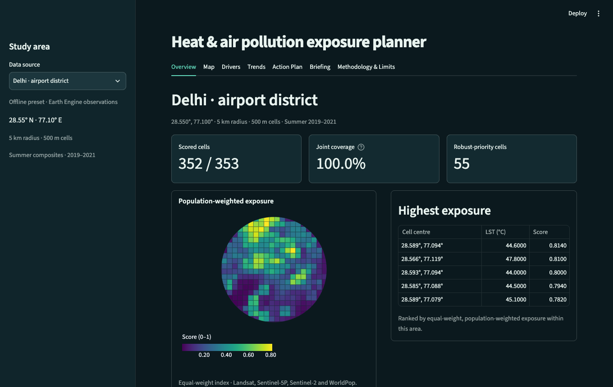
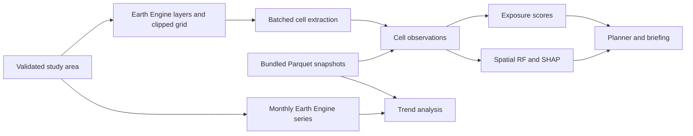

# Compound Heat & Air Pollution Exposure Planner

Explore where high land-surface temperature, elevated tropospheric NO₂ and low vegetation coincide with residential population. Select an area, inspect its grid cells, compare exposure rankings and estimate the modeled temperature change from converting bare ground to trees.



## Run from a fresh clone

Prerequisites on macOS or Linux are Git, Make, uv and Python 3.12. The first installation downloads the pinned packages from PyPI. Both bundled presets run offline after installation.

1. Clone the project. Replace `<repository-url-or-local-path>` with your Git remote or the path to a local copy of this repository.

   ```sh
   git clone --branch dev "<repository-url-or-local-path>" heat-exposure-planner
   cd heat-exposure-planner
   ```

2. Create the environment and install the hash-locked dependencies.

   ```sh
   mkdir -p .local/tmp
   UV_CACHE_DIR="$PWD/.local/uv" uv venv --python 3.12
   make install
   ```

3. Start Streamlit from the repository root.

   ```sh
   .venv/bin/streamlit run app.py
   ```

Open the **Local URL** printed by Streamlit, usually [localhost:8501](http://localhost:8501). The Delhi airport preset opens with **353 cells**. On **Map**, switch to surface temperature and click a cell for its LST, NO₂ and exposure score. Choose Bengaluru in the sidebar to load **355 cells**. Both presets cover a 5 km radius, use 500 m cells, and include summer composites and 36 monthly observations for 2019–2021. [Snapshot sources](data/demo/SOURCES.md) · [Mobile screenshot](docs/images/overview-mobile.png)

## Live Earth Engine analysis

Use a Cloud project registered for Earth Engine, with the Earth Engine API enabled and permissions for the account doing the computation. Copy the settings template, then set `EE_PROJECT` in the local `.env` to your project ID. [Earth Engine setup](https://developers.google.com/earth-engine/guides/access) · [IAM roles](https://developers.google.com/earth-engine/guides/access_control)

```sh
cp -n .env.example .env
```

The SDK reuses an existing Earth Engine login. For a first login, run `.venv/bin/earthengine authenticate` interactively. Restart the app after changing the project or credentials. Select **Custom live analysis**, enter latitude and longitude in degrees, choose a 1–15 km radius, a 250/500/1000 m cell size, years within 2019–2025 and a season. Click **Analyze area**. **Trends** has its own monthly-data request. [Authentication guide](https://developers.google.com/earth-engine/guides/auth)

## How to read the results

| View | What it shows |
| --- | --- |
| Overview and Map | Scored cells, valid-area coverage, hotspot locations and map layers for LST, NO₂, exposure and robust priority. Gray cells lack data for the selected layer. |
| Drivers | Held-out spatial R² and RMSE in °C, mean absolute SHAP importance and signed contributions to a selected cell’s fitted LST. |
| Trends | Monthly MODIS daytime/nighttime LST and Sentinel-5P NO₂, seasonal adjustment, annual Sen slopes, Mann–Kendall p-values and rolling urban/green comparisons. Shading identifies 2020. |
| Action Plan | Ranked planting candidates, cumulative share of summed exposure scores, converted area and modeled ΔLST with a 95% spatial bootstrap interval. |
| Briefing | Computed hotspots, robust-priority population share, drivers, selected intervention and caveats. Download cell attributes as CSV, WGS84 polygons as GeoJSON, and the brief as Markdown or HTML. |
| Methodology & Limits | Definitions, physical interpretation, time windows and sources of uncertainty. |

### Data and scoring

- **Heat and air.** Clear-sky Landsat 8/9 thermal observations supply median LST in °C. Landsat senses the surface, with roughly 100 m native thermal resolution. Sentinel-5P supplies the mean tropospheric NO₂ column in mol/m² after masking pixels with cloud fraction ≥0.3. Its footprint spans multiple cells. Ground-level air temperature and breathing-level NO₂ require different measurements.
- **Land and population.** Sentinel-2 optical indices use Cloud Score+ clear-pixel screening. Dynamic World supplies probabilistic land-cover classes. SRTM supplies elevation and slope. WorldPop residential counts use a fixed 2020 baseline and are summed on their native grid. The specified WorldPop collection is deprecated. [WorldPop catalog](https://developers.google.com/earth-engine/datasets/catalog/WorldPop_GP_100m_pop)
- **Index.** Within each area and period, rank LST anomalies relative to the area-weighted mean, NO₂ and NDVI using tied mid-percentiles. Green deficit is one minus the NDVI rank. Hazard is the weighted mean of the three factors. Exposure is hazard multiplied by population rank, with zero weight for zero estimated residents. Each forward scheme doubles its named factor. Robust-priority cells reach the top quintile under all four schemes. Scores compare locations within the current analysis; their numerical values depend on its boundary and period.
- **Time and coverage.** Time-varying exposure layers share the same years and months. Summer uses June–August in the northern hemisphere and December–February in the southern hemisphere, within the selected calendar years. Clouds and gaps can bias composites. Joint coverage measures the area with valid heat, NO₂, vegetation and population inputs. Cells with missing inputs stay in the export.

### Models and interpretation

The random forest predicts LST from land cover, spectral indices and terrain. Validation holds out whole 2 km blocks. At least 150 complete cells and three occupied blocks are required. Tree SHAP explains the fitted model. Correlated predictors can share credit, and nearby blocks can still resemble one another.

The planner screens cells of at least 1 ha with at least 25% combined bare, shrub or grass cover, zero classified water and less than 50% built cover. A 25% conversion moves one quarter of **existing bare cover** into trees. The model holds other predictors fixed. ΔLST is scenario minus baseline, in °C. The percentile interval comes from 100 paired spatial-block bootstrap refits. These are indicative associations. Field assessment is needed to establish access, planting feasibility and actual cooling.

Trends use all calendar months. Robust STL removes a 12-month seasonal cycle. The analysis needs 24 observed months, at least 80% completeness within the observed span and gaps of at most two consecutive months. Short gaps are interpolated for STL fitting only. Slopes use actual month spacing. Serial correlation can affect Mann–Kendall p-values. The urban/green comparison uses fixed Dynamic World classes and trailing three-month means.

## Architecture and operating limits



`app.py` wires the Streamlit tabs. Modules in `src/` implement validation, authentication, layers, grid construction, extraction and analysis. `src/ui/` renders those results. Downloads are generated in memory.

Live runs are capped at 2,500 cells and use batches of at most 500. A smaller radius or larger cell size can bring an oversized request within budget. Results are cached for 24 hours, with up to 50 entries per live data cache. Compute actions share a 10-second session cooldown. Earth Engine API sockets have a 90-second inactivity timeout and allow two SDK retries with backoff. Backend load can push extraction beyond the one-minute target. Monitor project quota when serving concurrent users. [Security and quota notes](SECURITY.md)

## Streamlit Community Cloud

1. Make the reviewed code and both Parquet presets available in a GitHub repository that Community Cloud can access. Keep `.env`, real secrets TOML and key files out of Git.
2. In Community Cloud, choose **Create app**, select the repository, select `dev` (or your release branch containing these files), and enter `app.py` as the entrypoint. In **Advanced settings**, choose **Python 3.12**. Community Cloud installs the root `requirements.txt`. [Deployment guide](https://docs.streamlit.io/deploy/streamlit-community-cloud/deploy-your-app/deploy) · [Dependency resolution](https://docs.streamlit.io/deploy/streamlit-community-cloud/deploy-your-app/app-dependencies)
3. The offline presets need no secrets. For live computation, give a dedicated service account **Earth Engine Resource Viewer** and **Service Usage Consumer** on the registered project. In **Secrets**, supply the two root-level settings from the template below. Replace both placeholders in the dashboard. Paste the complete service-account JSON as a TOML literal string, preserving the JSON’s escaped newlines. [Secrets template](.streamlit/secrets.toml.example) · [Cloud secrets guide](https://docs.streamlit.io/deploy/streamlit-community-cloud/deploy-your-app/secrets-management)

   ```toml
   EE_PROJECT = "your-project-id"
   EE_SERVICE_ACCOUNT_JSON = '''replace-with-complete-service-account-json'''
   ```

4. Choose **Deploy**. Confirm a preset map opens, then try a small custom ROI if live access is configured. On an authorization error, verify project registration, API enablement, roles and secret formatting. After grading, rotate the deployment key, restart with the replacement, verify a live request and revoke the old key. [Key handling](SECURITY.md)

## Verification and development

```sh
make check
.venv/bin/pytest -q -m live
```

`make check` runs offline pytest, Ruff and Bandit. The live suite uses the configured Earth Engine project, consumes quota, and includes a timed Delhi extraction. For development commits, install Gitleaks v8.24.3 on PATH or in `.local/bin`, then run `make hooks`. Update pinned dependencies in `requirements.in`, regenerate hashes with `make lock` and install with `make install`.

For release verification, run the locked dependency audit, Bandit and the full-history secret scan. The commands assume Gitleaks is on PATH.

```sh
.venv/bin/pip-audit --cache-dir .local/audit-cache --require-hashes --disable-pip -r requirements.txt
.venv/bin/bandit -r src app.py -q
gitleaks detect --log-opts=--all --redact
```

[Ten viva questions and answers](docs/VIVA.md) · [Milestone and QA record](PROGRESS.md)
